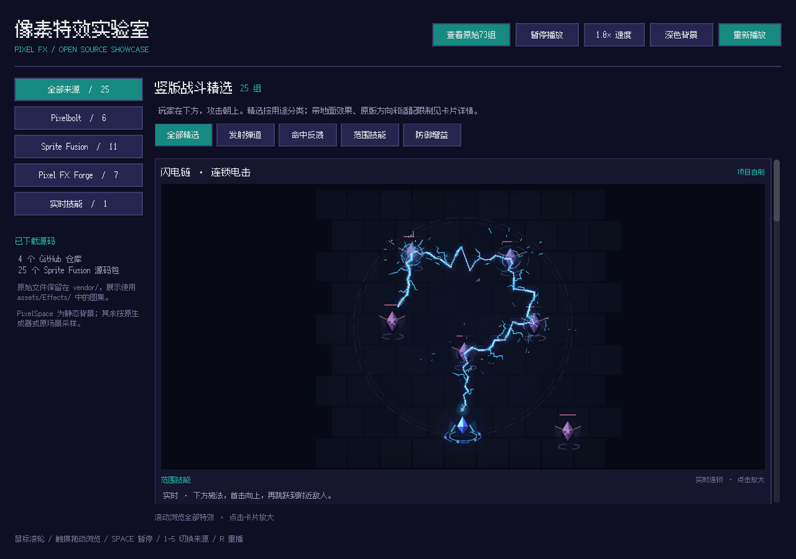

# 像素特效图鉴（Pixel FX Gallery）

一个 UrhoX 引擎下的**像素特效交互画廊**。把几个开源像素特效生成器的算法离线烘焙成透明 PNG 图集，再用 Lua + NanoVG 在游戏内统一播放、切换、放大查看；另外附一套实时程序化的闪电链技能演示。



## 内容

原始素材共 **73 组**，按来源分为 5 类：

| 来源 | 数量 | 类型 | 许可 |
|---|---|---|---|
| [Pixelbolt](https://github.com/skulitom/Pixelbolt) | 20 | 流体 / 粒子 / 波形动画 | MIT |
| [Sprite Fusion](https://www.spritefusion.com/pixel-art-vfx) | 25 | 像素特效动画 | MIT |
| [pixel-ability-fx-generator](https://github.com/GameDev-Toolkit/pixel-ability-fx-generator) | 12 | 技能特效动画 | Apache-2.0 |
| [PixelPlanets](https://github.com/Deep-Fold/PixelPlanets) | 12 | 行星 / 星系 / 黑洞 | MIT |
| [PixelSpace](https://github.com/Deep-Fold/PixelSpace) | 4 | 静态星空背景 | MIT（生成图不得单独分发） |

在此基础上提供 **竖版战斗精选（25 组）**：按用途重新归类为发射弹道、命中反馈、范围技能、防御增益，另加 1 个实时闪电链演示。精选只做元数据变体，不改动原始 73 组。

各来源的完整许可原文见 `assets/Licenses/`。

## 目录结构

```
scripts/               Lua 游戏代码
  main.lua             入口：画廊 UI、来源/用途筛选、连续滚动、详情弹窗
  EffectCanvas.lua     自定义 Widget，负责图集分帧绘制
  GalleryCatalog.lua   73 条原始特效元数据（路径、帧数、帧时长、许可）
  BattleCatalog.lua    竖版战斗精选：用途分类、适配说明与预览运动
  ChainLightning.lua   实时闪电链：选敌、跳跃时序与状态控制
  LightningArt.lua     闪电链美术：像素电弧、聚能、命中爆闪与残电
assets/
  Effects/             73 张透明 PNG 图集
  Fonts/               像素字体
  Licenses/            各来源许可原文
vendor/                原始生成器源码与元数据（构建时不打包）
  validation/tests/    运行时验收脚本（选敌、时序、交互、画廊回归）
```

## 特效是怎么来的

游戏运行**不依赖** Node、TypeScript、Godot 或浏览器。

1. 原始算法/场景在离线环境渲染成逐帧 RGBA
2. 合成透明 PNG 图集（8 列排布）
3. 运行时 Lua 按 `GalleryCatalog.lua` 里的帧时长顺序切帧绘制

图集使用最近邻采样（`NVG_IMAGE_NEAREST`），保证像素边缘锐利。

### 各来源的具体处理

- **Pixelbolt**：调用其 `compileFluid` / `compileEffects` / `compileWaves` → `renderProject` → `encodePNG`，取首个命名动画导出。
- **Sprite Fusion**：直接 import 其单文件 TS 生成器，逐帧调用 `update(dt)` / `draw(frame)`，把 color 与 additive light 两路合成为透明 RGBA。
- **pixel-ability-fx-generator**：用 `@napi-rs/canvas` 提供 Canvas2D 上下文，调用原始 `AbilityEffect.draw()`。
- **PixelPlanets**：用 Godot 4.4 headless 加载原始 `.tscn`，逐帧 `set_custom_time()` 后抓取 Viewport 纹理。
- **PixelSpace**：用 Godot 3.6 headless 固定 seed 调用 `generate_new()`，取静态背景。

## 实时闪电链

精选列表首位的「闪电链 · 连锁电击」不是烘焙帧，而是运行中实时绘制的：

- 施法者在下方，首击只选上方的最近目标，之后从上一命中点跳到附近尚未命中的目标
- 最多 5 个目标，每跳 0.14 秒，逐跳衰减 18%，超距即停止
- 电弧按完整骨架逐段「生长」，到达后才触发命中爆闪与冲击环
- 提供冰蓝 / 紫电 / 金雷三套配色，以及隐藏布景的纯特效模式

目标与血条目前是演示用的示意图，尚未接入正式战斗伤害与冷却。

## 操作

- 左侧切换来源，顶部切换「竖版战斗精选 / 原始 73 组」与用途分类
- 滚轮、滚动条或触摸拖动连续浏览，卡片点击放大详情
- `Space` 暂停 / 继续，`R` 重播，`1`–`5` 切换来源
- 顶部可切换 0.5× / 1× / 2× 速度与棋盘透明背景
- 闪电链详情内可切配色、场景/纯特效、重播（不会丢失当前状态）

## 关于改造

画廊播放的是**烘焙好的帧序列**，粒子轨迹已经写进每一帧，播放器无法实时改变重力。

若要修改这类特效的运动（例如做成无重力），需要改 `vendor/` 里对应的生成器参数或算法，重新导出图集，再更新 `GalleryCatalog.lua` 的元数据。

实时闪电链不受此限制，运动与时序都在 `ChainLightning.lua` 中直接控制。

## 构建

```bash
# 通过 UrhoX 官方构建工具，入口 scripts/main.lua
```
